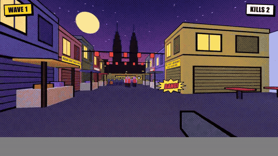
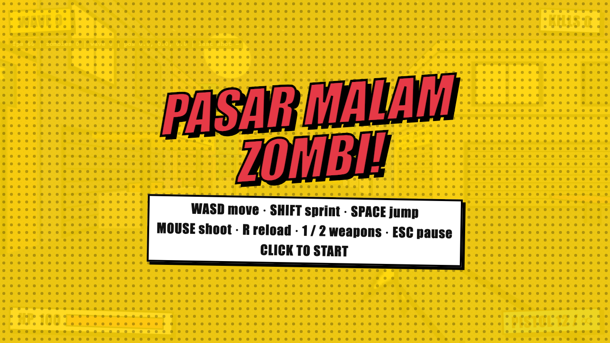
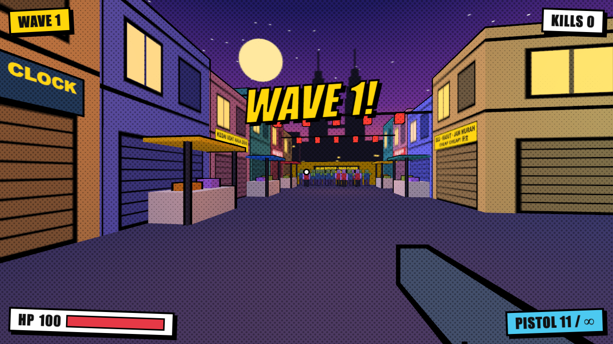
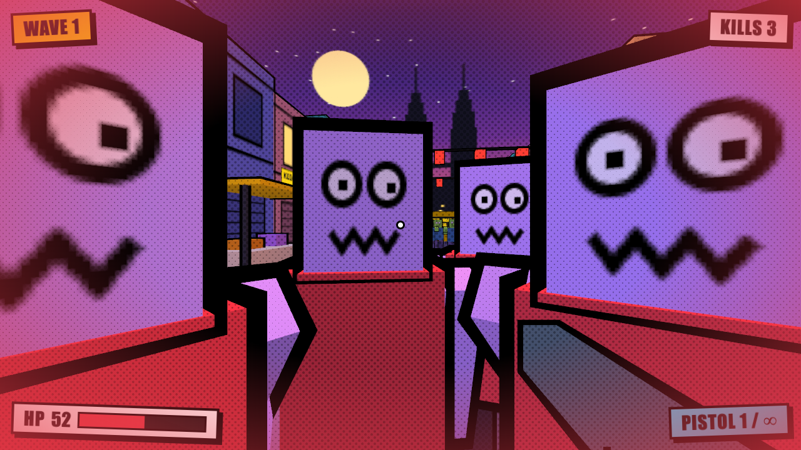

# Pasar Malam Zombi!

A comic-book first-person zombie shooter set in a Kuala Lumpur night market. Built with Three.js, TypeScript and Vite.

Built with AI coding agents for about $20 of API credit.



| Title | Wave start | Horde |
|---|---|---|
|  |  |  |

## Play

```sh
npm install
npm run dev      # http://localhost:5173
```

`npm run build` type-checks and writes a static build to `dist/`.

## Controls

| Key | Action |
|---|---|
| WASD | Move |
| Shift | Sprint |
| Space | Jump |
| Mouse | Aim and shoot |
| R | Reload |
| 1 / 2 | Pistol / shotgun |
| Esc | Pause |

Survive the waves. Clearing a wave drops health and ammo.
Add `?debug` to the URL for an FPS readout (toggle with <kbd>`</kbd>, <kbd>Z</kbd> spawns a horde).
